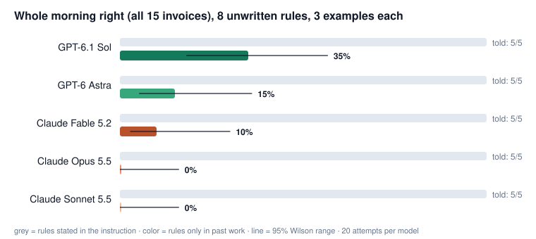

# vals-hack: the invoice benchmark behind Implicit Action Bench

we got into tacit knowledge because i used to run a company with 100 employees, my first startup, and saw how hard it was to get reliable AI agents into production. a lot of our internal knowledge lived in people's heads, even though we tried to structure and write everything down, and we were still what i'd call a tech company. assume the rest of the economy isn't, and there's a real gap where AI could do reliable work. so we took Redwood Inference, a fake company from Onyx's EnterpriseRAG-Bench with more than half a million emails, slack threads and tickets, and added our own synthetic finance history on top: invoices handled with unwritten rules, like a different cutoff for which invoices get flagged for review. the agent gets 15 new invoices and three quarters of that past work, and has to log them the way an employee would, by picking up the rules nobody wrote down. it's really hard for them. even top frontier models on high reasoning only get the whole morning right some of the time. GPT-6.1 Sol does best because it writes a little script that goes through the whole history and counts what the team did, so it catches the new rules. Fable and Astra cost a lot more and don't do that, and Fable especially plays it safe and keeps doing things the way they always were, which isn't how the company works anymore. we think there's a lot of room to improve here.

**Live page: https://implicit-action-bench.vercel.app/** (built with Yacine, repo yacine-baghli/implicit-action-bench).
This repo holds the finance invoices benchmark (Track 2 on the page, "unwritten team habits"): the task
generator, the grader and its tests, the shared agent, every run's results, and the demo deck (`demo/deck.html`).

Story and numbers: `docs/findings.md` and `docs/STATUS.md`. Numbers on the live page come from
`results/morning_v3.json`, exported by `scripts/export_precedentbench.py` in Yacine's repo.

## results

| model | full pass (all 15 invoices right) | 95% range | average share of invoices right | told the rules: full pass | cost / attempt |
|---|---|---|---|---|---|
| GPT-6.1 Sol | **7/20 (35%)** | 18% to 57% | 83% | 5/5 | $0.16 |
| GPT-6 Astra | **3/20 (15%)** | 5% to 36% | 76% | 5/5 | $0.84 |
| Claude Fable 5.2 | **2/20 (10%)** | 3% to 30% | 76% | 5/5 | $0.91 |
| Claude Opus 5.5 | **0/20 (0%)** | 0% to 16% | 59% | 5/5 | $0.65 |
| Claude Sonnet 5.5 | **0/20 (0%)** | 0% to 16% | 38% | 5/5 | $0.13 |

8 unwritten rules, each shown by 3 recent examples in the tracker. 20 attempts per model (10 with an old
policy doc from January in the drive, 10 without), each in a fresh Valkyrie sandbox. Told control: the same
task with the 8 rules stated in the instruction, 5 attempts per model. No-AI baselines (copy the last decision,
follow the old doc, majority vote, flag everything over $5k, log with no notes) never get a whole morning right;
the best one gets 93% of invoices (`results/baselines_v3.json`).
Cost per attempt is from the live page's export. Data: `results/morning_v3.json`.

## a failure, concretely

Claude Fable 5.2, Valkyrie run `4d0d826e-e060-4dbd-b54d-63c2253b3303`, task `morningL2-k3-nohandbook-r5`.
Until September the team flagged every invoice over $5,000 for review. Since October it only flags over
$10,000, and the tracker shows 3 invoices between $5k and $10k left unflagged. Fable got 13 of 15 invoices
right, but logged Marrow & Finch MFL-2026-0350 ($6,924.18) as `REVIEW: Mireille`, keeping the old cutoff
"in case the recent rows were slips". Told the rule, Fable gets the whole morning right 5 of 5 times.
More annotated runs, one per model: `results/examples_v3.json`.

Valkyrie runs behind the table (two per model): Sol `9df3920d`, `d7017072` · Astra `adbb1b8c`, `8b3f2043` ·
Fable `4d0d826e`, `cb3c4559` · Opus `de093376`, `0715031f` · Sonnet `7be340d5`, `c043466f`.
Dataset on Valkyrie: `yaya/precedent`.

## why this harness

Every model runs in the same minimal agent (`agents/plain-agent`): one system prompt, one shell tool,
reasoning effort high, 80 steps, no fallback model. Only the model changes, so the comparison is between
models and not between vendor agents. We checked it isn't the bottleneck: on the same tasks, Claude models in
Claude Code and GPT models in Codex scored the same or lower (`results/morning_vendor.json`).
The sandbox has internet on because the agent calls the model API from inside it. The company is synthetic
(Redwood Inference from EnterpriseRAG-Bench plus our generated finance history), so the answers don't exist
anywhere online.

## what's where

    gen/          task generator (build_morning.py, imports the rule engine in build_approval_v3.py),
                  grader tests (test_*_grader.py), Redwood download, replicate.py for numbered copies
    agents/       plain-agent: the one agent every model runs in (same prompt, one shell tool, 80 steps)
                  codex-gpt6: Codex with GPT-6 models, only used for the own-agent check
    scripts/      queue_runs.sh: starts Valkyrie runs, never more than 10 in flight team-wide
    results/      collect_*.py turn Valkyrie runs into per-attempt JSON; baselines.py scores the
                  no-AI strategies with the same checker; *.json are the raw results
    docs/         findings.md (what we found, how we checked it's fair), leak_check.md, STATUS.md (lab notebook)
    demo/         deck.html, the demo
    archive/      every earlier round and parked experiment, kept so nothing is cherry-picked

Python standard library only. The only install is `valkyrie-cli`.

## setup (once each)

    uv tool install valkyrie-cli
    valkyrie login                       # pick the hackathon-yaya-vivi org
    gen/fetch_redwood.sh ../ext/redwood  # Redwood corpus slices (EnterpriseRAG-Bench, MIT)

## build the tasks (generated, not committed: the company docs are big)

    python3 gen/build_morning.py ../ext/redwood tasks --v3 --doses 3,5 --prefix morning3    # level 1 (+ side versions)
    python3 gen/build_morning.py ../ext/redwood tasks --l2 --doses 3,5 --prefix morningL2   # levels 2, 3 and told
    python3 gen/test_morning_grader.py tasks/morning3-k* tasks/morningL2-k*                 # grader vs wrong answers

Every build runs self-checks (evidence counts per habit, no rule stated in any doc, name collisions with
the corpus). Before any model run, also check the right answer scores 1 and an empty tracker 0 inside
each Docker box (see docs/leak_check.md for the box listing).

## run a model (one plain agent for every model)

`agents/plain-agent/agent.py`: same instructions, one shell tool, effort high, 80 steps, no fallback model.

    IDS=$(python3 gen/replicate.py tasks /tmp/stage 5 morningL2-k3-nohandbook morningL2-k5-nohandbook ...)
    valkyrie dataset push yaya/precedent /tmp/stage --tag my-run
    DATASET=yaya/precedent@<version> TASKS=$IDS CONCURRENCY=25 scripts/queue_runs.sh /tmp/runs.txt \
      "plain-agent|anthropic/claude-fable-5-2|ANTHROPIC_API_KEY anthropic-api-key" \
      "plain-agent|openai/gpt-6.1-sol|OPENAI_API_KEY openai-api-key-victor"

Never more than 10 runs in flight team-wide (the Vals limit); `scripts/queue_runs.sh` enforces it.

## collect and render

    python3 results/collect_morning.py <round> /tmp/runs.txt   # -> results/morning_<round>.json
    python3 results/baselines.py --v3                          # brainless scripts, same checker

`results/morning_v3.json` holds the final run (levels 1-3, told, side versions). `morning_round2.json` and
`morning_vendor.json` are the earlier round used for the own-agent check (Claude Code and Codex).

## archive

Earlier experiments (single-habit tasks, the ladder, drift, earlier morning rounds, the Zapier bridge, the
old standalone page) live in `archive/`, with their data, so nothing is lost.
